# VFS Unreal Project Build Tool v0.20.0

### Contents

- [Summary](#summary)
- [Tools Required](#tools-required)
- [How To Install](#how-to-install)
- [Steps for each action](#steps-for-each-action)
  - [Every action](#every-action)
  - [Build Solution](#build-solution)
  - [Regenerate Visual Studio project files](#regenerate-visual-studio-project-files)
  - [Package Build](#package-build)
  - [Upgrade Project Version](#upgrade-project-version)
  - [Rename Project](#rename-project)
- [Messages you might see](#messages-you-might-see)
- [Limitations](#limitations)
- [Known Issues](#known-issues)
- [Patch Notes](PatchNotes.md)

---

### Summary

- One app for Unreal Engine **C++ projects**. No editor needed for building or packaging.
- Five actions:
  - **Build Solution**: compiles the project.
  - **Regenerate Visual Studio project files**: deletes the generated files, regenerates the project files, builds solution.
  - **Package Build**: cooks and packages a Windows build.
  - **Upgrade Project Version**: moves the project to a newer installed engine.
  - **Rename Project**: renames the project without breaking Blueprints, levels or saved values.
- **Updates itself.** On opening, it checks GitHub for a newer version. If there is one, a small window shows the download progress, then the new version opens.
  - Works offline: with no connection it opens the version you have.

---

### Tools Required

- A C++ Unreal Project.
- Windows 10 or 11.
- Unreal Engine 5 (Epic Games Launcher, or a registered source build).
- Visual Studio with the **Game development with C++** workload: **2026 or higher for Unreal 5.8 and newer**; 2022 or 2026 for older versions.
- `VFSUnrealProjectBuildTool.exe` (see [How To Install](#how-to-install)).

---

### How To Install

1. Download [VFSUnrealProjectBuildTool.exe](https://github.com/vfs-sct/VFS_Unreal_Project_Build_Tool/raw/main/VFSUnrealProjectBuildTool.exe).
2. Put it in a folder you own, for example `Documents\Tools`. Not `Program Files`: the app can't update itself there.
3. Double-click it to open it. Nothing else to install.
   - Windows may warn that the app is unrecognised (it isn't signed): click **More info → Run anyway**.
4. From now on it updates itself when you open it.

---

### Steps for each action

#### Every action

1. Close the project in Unreal Editor, Visual Studio and Rider.
2. Open `VFSUnrealProjectBuildTool.exe`.

   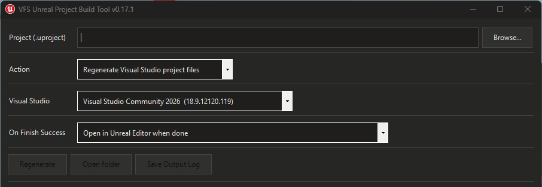

3. **Project (.uproject):** click **Browse...**, or drag the `.uproject` (or its folder) onto the window.

   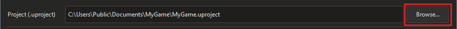

4. **Action:** pick one of the actions below and follow its steps.

   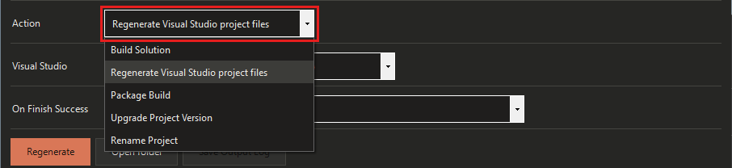

5. When it finishes, check everything in the yellow list at the end of the log.

   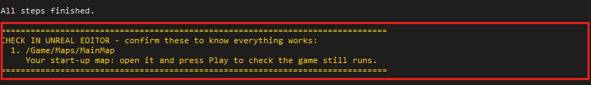

- **Visual Studio** is picked for you. Change it only if you need a specific version.
- **Cancel** stops a run. For builds and packaging nothing is lost.
- **Save Output Log** saves the log as a `.txt` (useful when asking for help).
- **Copy Output Log** copies the whole log, ready to paste into a message. Both are greyed out while an action runs.
- **Open folder** opens the project folder, or the packaged build after Package Build.

#### Build Solution

1. Optional: tick **Rebuild Solution** to clean and build everything from scratch (slower; use it when a normal build acts up). Hover over it for an explanation.

   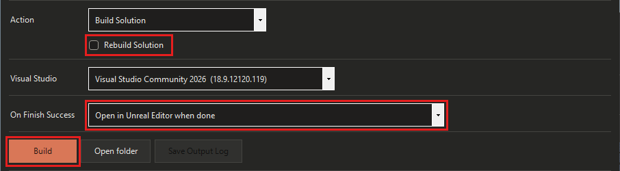

   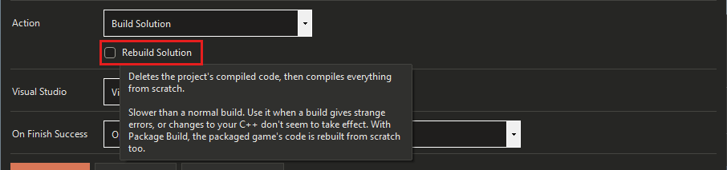

2. **On Finish Success:** **Open in Unreal Editor when done** (default) or **Do nothing**.
3. Click **Build** (it says **Rebuild** when Rebuild Solution is ticked).
4. Check the yellow list: open your start-up map and press Play.

   

#### Regenerate Visual Studio project files

Use when Visual Studio or IntelliSense is confused.

1. **On Finish Success:** **Open in Unreal Editor when done** (default) or **Do nothing**.

   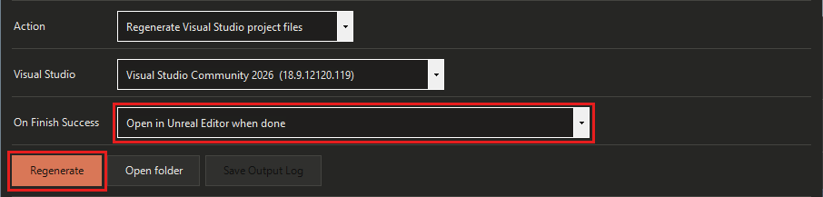

2. Click **Regenerate**. It:
   - Deletes `.vs`, `Binaries`, `DerivedDataCache`, `Intermediate`, `.vsconfig`, `*.sln`, `*.slnx` (whichever exist).
   - Regenerates the Visual Studio project files.
   - Builds the project.
3. Check the yellow list: open your start-up map and press Play.

- `Content`, `Source`, `Config` and `Saved` aren't touched.
- The next editor launch and the next cook are slower once (the deleted cache is rebuilt).

#### Package Build

1. Optional: tick **Rebuild Solution** to clean and rebuild the code first.
2. **Build:** **Development** (default) or **Shipping**.
3. Optional: tick **Clean cook content** to delete old cooked data and cook everything (slower; safest after a rename). Unticked, only changed content is recooked. Hover over it for an explanation.

   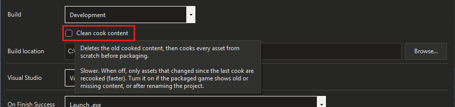

4. **Build location:** defaults to `<project>\Builds`. Click **Browse...** to change it. Package is greyed out while it's empty.
5. **On Finish Success:** **Launch .exe** (default), **Open in Unreal Editor when done**, or **Do nothing**.

   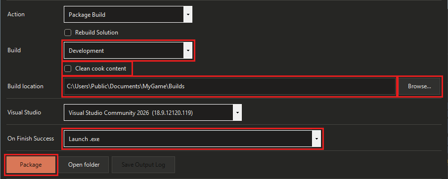

6. Click **Package**.
7. Check the game in **CONFIRM WORKING BUILD** at the end of the log: it opens, loads the first level and plays.

   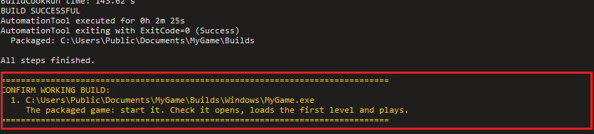

#### Upgrade Project Version

1. Commit or back up the project first. Assets saved in the newer engine can't be opened in the old one.
2. **Engine version:** pick the engine to upgrade to (defaults to the newest installed). Older engines are blocked.
3. **On Finish Success:** **Open in Unreal Editor when done** (default) or **Do nothing**.

   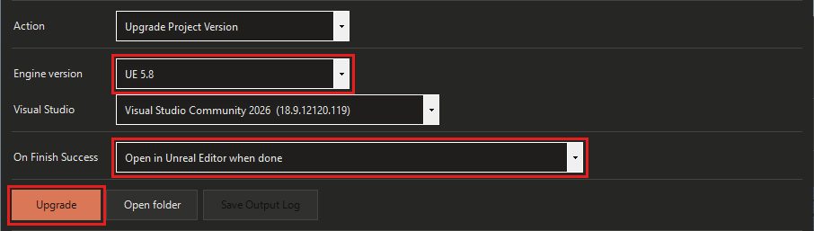

4. Click **Upgrade** and confirm. It:
   - Switches the project's engine (works even if the project's current engine isn't installed).
   - Updates `DefaultBuildSettings` and `IncludeOrderVersion` in `Source/*.Target.cs` to the new engine's latest.
   - Deletes the same files as Regenerate.
   - Regenerates the project files and builds with the new engine.

   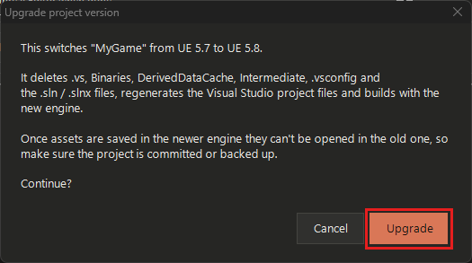

5. Open the project and check **Window > Message Log** for upgrade warnings.

#### Rename Project

1. Commit or back up the project first. The rename changes files in place.
2. Rename on **one machine only**. Teammates get it from the commit.
3. **New name:** letters, digits and underscores, starting with a letter, up to 20 characters (e.g. `SpaceRacer`). Not allowed: Windows reserved names (`CON`, `NUL`, `COM1`…), C++ keywords (`class`, `int`…), or only changing the capitalisation.
4. **On Finish Success:** **Open in Unreal Editor when done** (default) or **Do nothing**.

   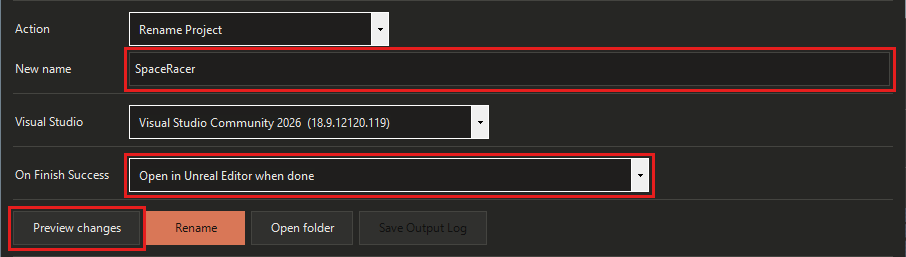

5. Click **Preview changes** and read the list. Nothing is changed yet.

   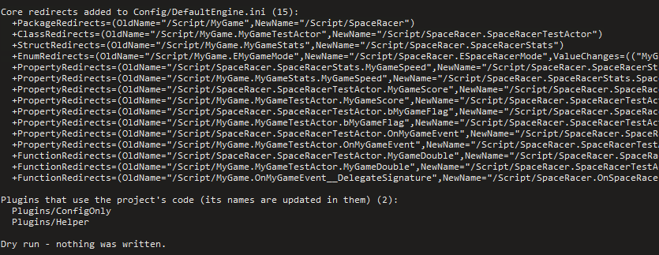

6. Click **Rename** and confirm. It:
   - Renames the `.uproject`, modules, source files, `_API` macros and config entries.
   - Adds `[CoreRedirects]` to `Config/DefaultEngine.ini` so assets find the renamed C++ names.
   - Regenerates the project files and builds.
   - Resaves assets that use the old names (assets that load with warnings are **skipped**, never saved broken).
   - Removes redirects no asset needs any more.
   - Checks every plugin still loads.

   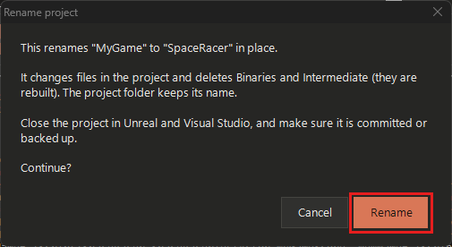

7. Check everything in the yellow list. Open each **SKIPPED** asset, fix its warning, and save it.

   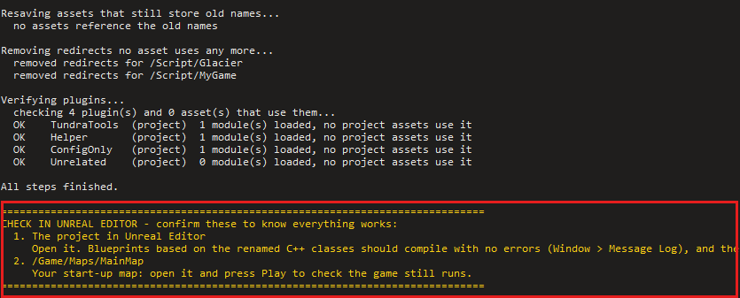

8. Commit everything in one go: renamed files, deleted old files, `DefaultEngine.ini`, resaved assets.
   - Keep the `[CoreRedirects]` lines.
   - If other branches or shipped save games still use the old names, add back any redirect lines the log says were removed.
9. Teammates: sync, delete `Binaries` and `Intermediate`, open the new `.uproject`.

---

### Messages you might see

| Message | What it means / what to do |
|---|---|
| **"... is open in Unreal Editor / Visual Studio / Rider"** | Close the project there, then click **Check again**. |
| **Note under Visual Studio** (main button greyed out) | This Visual Studio, its C++ compiler or the Windows SDK isn't one the engine accepts. The note says what to install or update in the Visual Studio Installer. |
| **"This project's engine ... isn't installed on this PC"** | Install that engine, or use **Upgrade Project Version** to move the project to an installed one. |
| **"errors in plugin: ..."** (after a failed build) | That project plugin doesn't compile with this engine, usually because it's built for an older one (common after an upgrade, e.g. FMOD). Get the plugin's version for your engine, replace its folder in `Plugins`, and run again. |
| **"Checking for updates..." / "Updating to v..."** (on opening) | The app is checking for or installing a newer version; the new version opens by itself. Close that window to skip the update this time. |
| **Update failed** (on opening) | The new version couldn't be installed, usually because the app's folder can't be written to (e.g. `Program Files`). Move the app to a folder you own, like Documents, or download it from GitHub. The current version still opens. |
| **Build failed / Package failed / Regenerate failed** (popup) | The popup says which step failed (project files, build, cook or packaging). Look for `error` lines in the log, or click **Save Output Log** / **Copy Output Log** to share it. |
| **"warning: couldn't delete ..."** (Regenerate, Upgrade) | A file is in use. Close Visual Studio, Rider and the editor, then run it again. |
| **"Choose a Build location for the packaged game"** (Package greyed out) | Build location is empty. Click **Browse...** and pick a folder. |
| **"Pick the engine version to upgrade to"** (Upgrade greyed out) | No newer engine is installed, or the project already uses the selected one. |
| **Engine downgrade blocked** | You picked an older engine than the project uses. Assets saved by a newer engine can't be opened by an older one, so this is refused. Pick the same or a newer engine. |
| **Common project name** (Rename) | The old name is a common word (like `Game` or `Character`) that's also in engine names. To be safe, only the project's **own** names are renamed: modules, files, its classes, properties and functions. Local variables, comments and text that contain the word stay as they are. Click **Rename anyway** to continue, or **Cancel**. |
| **"... is a reserved name in Windows" / "... is a C++ keyword" / "Only the capitalisation changes"** (Rename greyed out) | The new name can't work: Windows won't create files called `CON`, `NUL`, `COM1` and so on; C++ keywords like `class` break the build; and Windows treats `MyGame` and `mygame` as the same file name. Pick a different name. |
| **"... would clash with ... from the engine or a plugin"** (Rename) | The new name would collide with something that already exists (for example `Water` or `Engine`). Pick another name. Nothing was changed. |
| **"... paths of N characters"** (Rename) | The renamed files would be too deep for Windows' 260-character path limit. Move the project to a shorter folder (e.g. `C:\Projects\`) or use a shorter name. |
| **"Plugin '...' contains the old name; it is NOT renamed"** (Rename) | Information only. Plugins aren't renamed, so their names are left alone. |
| **"Renamed, but a follow-up step needs attention"** (Rename) | The rename worked, but the build, asset resave or plugin check reported a problem. The popup and the yellow list say which. |
| **SKIPPED `<asset>` (loaded with warnings)** (Rename) | That asset already had a problem (shown on the `why:` line), so it wasn't resaved. It still works through the redirects. Open it in the editor, fix the warning and save it. |
| **saved `<asset>` (with warnings ...)** (Rename) | The asset was resaved, but something was logged (shown on the `why:` line). Open it and check it looks right. |
| **WARN `<plugin>`** (Rename, plugin check) | The plugin loads, but some assets that use it log warnings when loaded (listed below it). Usually old issues; check them in the editor. |

---

### Limitations

- C++ projects only. Blueprint-only projects (no `Source` folder) aren't supported.
- Windows only. Package Build makes Windows (Win64) builds only.
- The app can't update itself from a folder you can't write to (e.g. `Program Files`); keep it in a folder you own.
- No automatic backup or undo. Commit before Rename or Upgrade.
- Projects in OneDrive or other synced folders can have files locked mid-run. Pause syncing first.
- Rename doesn't change:
  - The project folder name.
  - `Content` folders and asset names (`/Game/...` paths), including folders named after the project.
  - Engine and plugin names, or your plugins' own names.
  - Other files that mention the old name (build scripts, CI workflows, `.gitignore`, docs other than the root README).
  - Other spellings of the name (e.g. `mygame`).
- Rename removes class and module redirects that no asset in **your** copy uses. Other branches, unsynced machines or shipped save games may still need them (add them back from your previous commit).
- Common names (like `Game`) only rename the project's own names; local variables and comments keep the word.
- Regenerate and Upgrade delete `DerivedDataCache`, so the next editor launch and cook are slower.

---

### Known Issues

- A folder with several `.uproject` files uses the first one without asking.
- Some project-wide editor warnings can still be blamed on whichever asset loads first, so that asset is skipped. Only the Gameplay Ability System's "No GameplayCueNotifyPaths" warning is filtered out.

---

### Patch Notes

What changed in each version: see [PatchNotes.md](PatchNotes.md).
